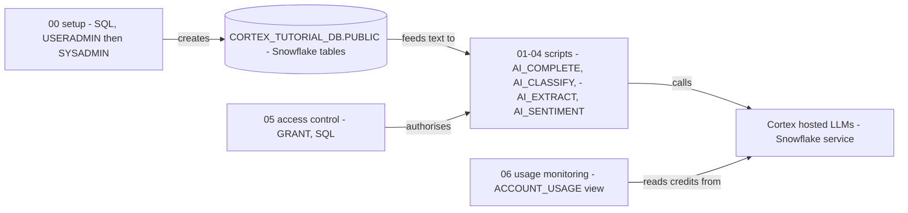

# Snowflake Cortex AI - Architecture and design rationale

*Last updated: 2026-11-07 · commit 2edefc322*

## 1. Purpose and scope

A short learning tutorial on Snowflake Cortex AI functions: generating text, classifying it, extracting fields from it,
scoring its sentiment, then controlling and monitoring who can use these functions. It is aimed at someone who already
writes Snowflake SQL and wants to see the AI functions used on small, readable examples.

It is not a production design, not a benchmark and not a guide to model choice or cost. The repository does not say
which kind of Snowflake account the scripts were run against (trial, sandbox or other), so that is not documented here
(`TODO: verify`).

## 2. How this project was built

This project was built with Claude Code (Anthropic's AI coding assistant) in a complementary role. Elliott Fairhall is
the author and owner: the project is debugged, tested and used by him for learning and development, and the design
decisions below are explained so that they can be understood, questioned and learned from. AI assistance does not
replace that work. The repository does not record how much of each script was run or reviewed, so the document makes no
claim about that beyond the statement above.

## 3. Architecture at a glance

The project has no application code. It is a set of SQL scripts and one walkthrough, all executed inside Snowflake.

Script 00 creates three small tables of invented text. Scripts 01 to 04 each call one function. Script 05 shows the
grants that let a role call them, and script 06 reads the usage view that reports what they cost.

## 4. Learning path

| Order | Script                      | Teaches                                                          | Why here                                                                                                      |
| ----- | --------------------------- | ---------------------------------------------------------------- | ------------------------------------------------------------------------------------------------------------- |
| 00    | `00_setup_environment.sql`  | Own database, three sample tables, grants for the running role   | Everything later needs data and permission to call the functions                                              |
| 01    | `01_text_generation.sql`    | `AI_COMPLETE` with a model name and a prompt, then over a column | The most general function; every other one is a narrower version of "prompt in, text out"                     |
| 02    | `02_classification.sql`     | `AI_CLASSIFY` with a category list, and `output_mode: multi`     | First constrained output: a label from a fixed set instead of free text                                       |
| 03    | `03_extraction.sql`         | `AI_EXTRACT` with a field-to-type map                            | Constrained output again, now producing structured fields; staged documents appear as a commented placeholder |
| 04    | `04_sentiment_analysis.sql` | `AI_SENTIMENT` as a number, then thresholds in a `CASE`          | Shows turning model output into a number that SQL can filter and sort                                         |
| 05    | `05_access_control.sql`     | `SNOWFLAKE.CORTEX_USER` and `USE AI FUNCTIONS` grants            | Governance follows capability: the learner knows what is being governed first                                 |
| 06    | `06_usage_monitoring.sql`   | `CORTEX_FUNCTIONS_USAGE_HISTORY`                                 | Last, because cost only means something once the calls have been made                                         |

The order moves from least to most constrained output (free text, label, fields, score) and ends with the operational
concerns. Documented in the README: the scripts are "extracted from the tutorial" and run by number. The reason for the
progression itself is inferred from the script order and listed in section 10.

## 5. Isolation, idempotency and cleanup

- **Isolation:** one database, `CORTEX_TUTORIAL_DB.PUBLIC`. No warehouse, role or user is created; scripts run with the
  caller's current role and warehouse.
- **Re-running:** script 00 is re-runnable (`IF NOT EXISTS` for database and schema, `CREATE OR REPLACE` for tables,
  which reloads the seed rows). Scripts 01 to 04 only read. Script 05 grants are repeatable.
- **Cleanup:** none provided. Drop the database by hand.
- **Cost and safety:** each AI call bills tokens; the examples are three rows or one literal string. Sample text is
  invented and holds no personal data.

## 6. Design rationale

### Teach with SQL only, one function per script

- **Why:** the audience already knows SQL, the point is that no model deployment or data movement is needed (stated in
  `Tutorial/CORTEX_AI_TUTORIAL.md`), and a 10 to 25 line script can be read in one go.
- **Gave up:** no Snowpark, no pipelines, no combining functions on one table, no evaluation of answer quality.
- **Alternative not taken:** a notebook or Python walkthrough. It would add a runtime and hide the one-line SQL call
  that is the selling point.
- **Evidence:** documented (tutorial introduction); the one-function-per-script shape is inferred from the code.

### Invented, in-line sample data in its own database

- **Why:** three rows per table (feedback, tickets, reviews) are enough to see each function work, cost almost nothing
  in tokens, and avoid any real customer text. Script 00 uses `CORTEX_TUTORIAL_DB`, a name no other tutorial uses, so it
  does not touch another project's objects.
- **Gave up:** three rows cannot show variance, cost at scale or model disagreement.
- **Alternative not taken:** a public dataset or a larger generated one; more realistic, but heavier to load and to
  explain.
- **Evidence:** inferred from the code.

### Run setup with least-privilege roles, in the PUBLIC schema, with `CREATE OR REPLACE TABLE`

- **Why:** `USERADMIN` creates the `CORTEX_TUTORIAL_ROLE` role (and grants it to `SYSADMIN`), `SYSADMIN` owns the
  database and tables and grants `USAGE` and `SELECT` on them to that role, and the learner runs the tutorial as
  `CORTEX_TUTORIAL_ROLE`. `ACCOUNTADMIN` is not used anywhere in the tutorial. `CREATE OR REPLACE` makes script 00 safe
  to re-run to reset the data; script 00 re-issues the table grants at the end because a replace drops them.
- **Gave up:** a re-run replaces each table, so rows added since are no longer in it (Snowflake keeps the old version
  only in Time Travel, where retention allows, and it counts towards storage). That is acceptable for three seeded rows
  in a tutorial-only database and would not be acceptable anywhere else; the project's code-quality guidance says to
  prefer `CREATE OR ALTER` for tables that hold data.
- **Alternative not taken:** `CREATE TABLE IF NOT EXISTS` plus a truncate, or a separate teardown script. The repository
  has no teardown script (see section 8).
- **Evidence:** inferred from the code.

### Leave most data queries commented out

- **Why (reconstructed):** scripts 01, 02 and 04 keep the table-based example inside `/* ... */` and run only a literal
  string call. A literal call works without any table and bills a single short prompt. See section 10.
- **Gave up:** the sample tables from script 00 are created but, as written, never queried by a script that runs
  uncommented. A learner has to uncomment the block to use them. Script 01 calls the table "hypothetical" although
  script 00 creates it.
- **Alternative not taken:** run the table queries directly; closer to real use, slightly more token spend.
- **Evidence:** inferred from the code.

### Show grants and the usage view, but not budgets

- **Why:** the tutorial states that the functions cost credits by tokens processed and that a warehouse larger than
  MEDIUM does not speed them up; script 06 gives the learner a way to see consumption. The tutorial states the default
  access position (`CORTEX_USER` and `USE AI FUNCTIONS` granted to `PUBLIC` by default) in prose.
- **Gave up:** no resource monitor, budget, or guidance on limiting a model's token use. No pricing figures are given in
  the repository, and none are asserted here (`TODO: verify` any current rates and the default-grant statement against
  Snowflake's documentation).
- **Alternative not taken:** a cost-guardrail chapter. Reasonable follow-on material.
- **Evidence:** documented (tutorial section "Access Control and Costs").

### Trade-offs against production practice

| Tutorial choice                                                                                     | Production practice                                                                                             |
| --------------------------------------------------------------------------------------------------- | --------------------------------------------------------------------------------------------------------------- |
| Rely on the default `PUBLIC` Cortex grants through a dedicated tutorial role, no `ACCOUNTADMIN` use | Same, with named functional roles per team; `ACCOUNTADMIN` kept for administration only                         |
| Hard-coded model name `llama3.1-70b`                                                                | Model name held in configuration; availability and region support checked (`TODO: verify` current availability) |
| Free-text answers read by eye                                                                       | Evaluation set and acceptance thresholds for classification and extraction                                      |
| Thresholds of +/-0.3 for sentiment                                                                  | Thresholds tuned against labelled examples                                                                      |

## 7. Quality and testing

There are no automated tests and no stated expected outputs in the scripts. The tutorial gives no sample result sets for
the AI calls. A learner checks the output by reading it; model answers vary between runs and models. The repository does
not record a verification run (`TODO: verify`).

## 8. Constraints, limitations and known gaps

- No teardown script: `CORTEX_TUTORIAL_DB` stays until dropped by hand.
- No `USE WAREHOUSE` in any script; the learner must have a current warehouse.
- Script 00 no longer grants `SNOWFLAKE.CORTEX_USER` or `USE AI FUNCTIONS`; it relies on the tutorial's statement that
  `PUBLIC` holds both by default, which Snowflake's documentation confirms (checked 2026-11-07, "Access control
  requirements" for Cortex AI functions). If an account has revoked them from `PUBLIC`, `ACCOUNTADMIN` must grant them
  to `CORTEX_TUTORIAL_ROLE`: the documentation says `ACCOUNTADMIN` is required to manage `USE AI FUNCTIONS`.
- Script 00 has not been run against a Snowflake account since the role change. The script 00 setup also still needs
  `USERADMIN`, `SYSADMIN` and a user granted `CORTEX_TUTORIAL_ROLE`, which the learner adds by hand.
- Script 05 now grants to `CORTEX_TUTORIAL_ROLE`, which script 00 creates (changed 2026-11-07; it previously granted to
  an `analyst` role that no script created). The grants need an administrator and are only needed if the `PUBLIC`
  defaults were revoked.
- Script 06 reads `SNOWFLAKE.ACCOUNT_USAGE`, which needs a role with access to that schema and can lag behind real usage
  (`TODO: verify` latency).
- The README lists a `data/` folder of "sample data placeholders" that does not exist in the repository.
- The README structure listing omits `00_setup_environment.sql`, which its own text tells the learner to run first.
- Function names, options and model names reflect the tutorial's writing date and are not checked against current
  documentation.

## 9. Running and extending

See the [README](../README.md) for setup and the [tutorial](../Tutorial/CORTEX_AI_TUTORIAL.md) for the walkthrough. To
add a function, copy the shape of an existing script: header comment, one literal-string call that runs anywhere, one
commented table example against a script-00 table, and add its table to script 00 in the same change. Keep object names
inside `CORTEX_TUTORIAL_DB`.

## 10. Rationale (confirmed by the owner)

Confirmed by Elliott Fairhall on 2026-11-07. This reasoning was first reconstructed from the code and commit history;
the owner has since agreed it is correct, so it is now the stated rationale rather than an inference.

- The progression runs from free text to label to fields to score on purpose, as a ladder of increasing output
  constraint.
- Table-based examples are commented out so that the scripts run cheaply and without depending on script 00 having run.
- `ACCOUNTADMIN` was originally granted access in script 00 for convenience on a personal account, not as a
  recommendation. It has since been removed in favour of a dedicated tutorial role (2026-11-07), because `ACCOUNTADMIN`
  should be kept for account administration.
- `CORTEX_TUTORIAL_DB` was a deliberately isolated database so the tutorial cannot disturb other work.
- Access control and monitoring come last because they are operational concerns that only make sense after the functions
  have been used.
- The account used was a personal or trial style account (confirmed by the owner).
